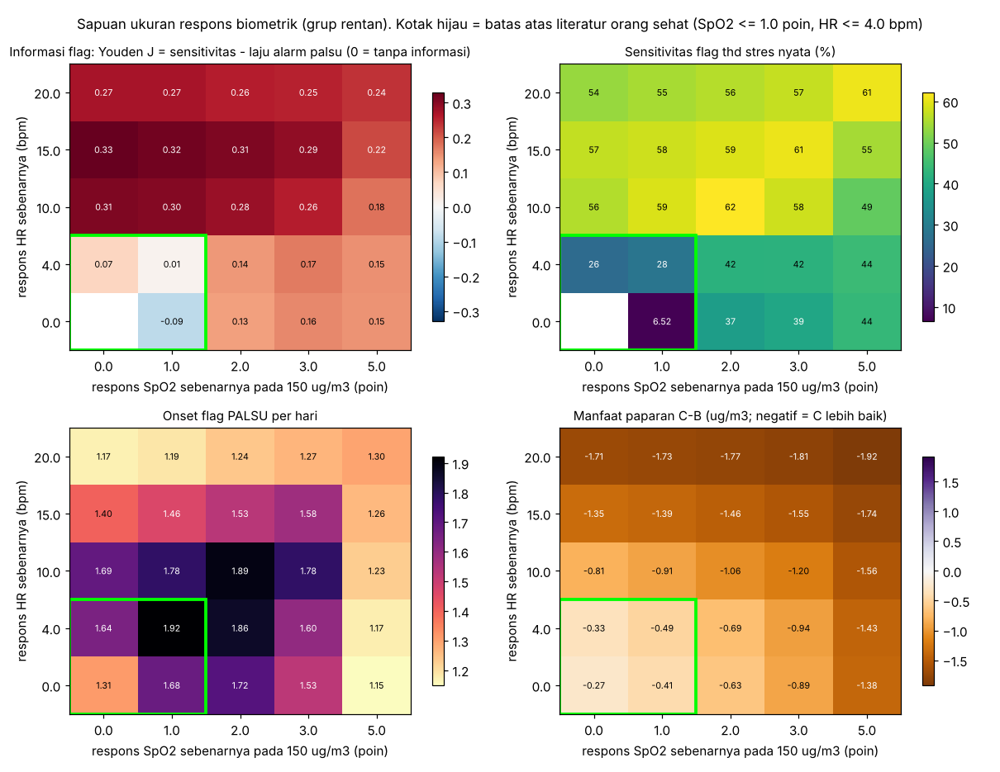
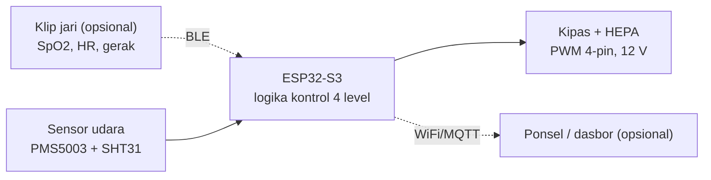
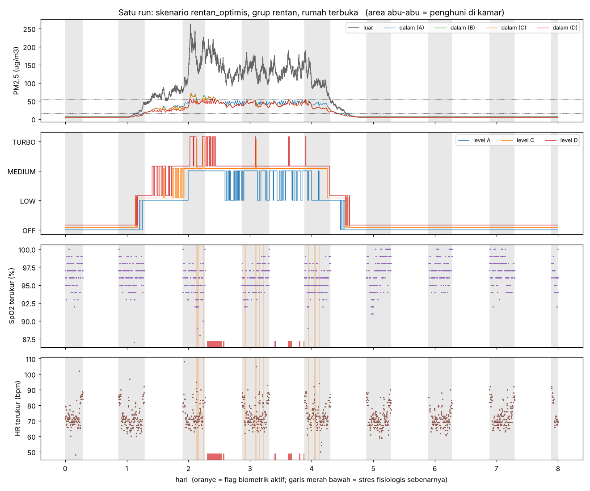

# Purifier HEPA Adaptif untuk Asap Karhutla

[](https://github.com/<USER>/purifier-hepa-adaptif/actions/workflows/ci.yml)


Purifier HEPA yang mengatur kipasnya sendiri dari sensor debu PM2.5, dengan **klip jari opsional** (SpO2 dan detak jantung) yang diuji manfaatnya lewat simulasi. Repo ini berisi **simulator** (digital twin tanpa perangkat keras), **firmware ESP32-S3**, dan **dokumentasi riset** di balik asumsinya.

> **Bukan alat medis.** Proyek ini prototipe riset/hobi. Tidak untuk diagnosis atau keputusan kesehatan. Jika ada gejala atau SpO2 rendah yang menetap, hubungi tenaga kesehatan.

## Temuan utama (dari simulasi)

Pertanyaan: *apakah menambahkan biometrik ke kendali kipas memberi manfaat dibanding PM2.5 saja?*

- **Profil kerentanan statis** (ambang lebih rendah untuk pengguna asma/lansia) memberi manfaat terbesar: paparan turun sekitar 8%.
- **Biometrik menambah sangat sedikit** pada asumsi sekarang: paparan turun kurang dari 2 µg/m³ (dari ±70–76), dengan 1–2 alarm palsu per hari. Flag baru cukup informatif bila respons detak jantung sebenarnya sekitar 10 bpm atau lebih, kira-kira 2,5× lebih besar dari yang ditemukan literatur.
- **Jenis rumah lebih berpengaruh daripada logika kontrol:** rumah berventilasi terbuka rata-rata ±74 µg/m³, tertutup ±44 µg/m³.



Ini hasil **bersyarat pada asumsi** dan belum divalidasi dengan data lapangan. Rincian, angka lengkap, dan batasannya ada di [docs/hasil-simulasi.md](docs/hasil-simulasi.md).

## Arsitektur



Garis putus-putus = opsional. Versi paling sederhana hanya sensor udara, ESP32-S3, dan kipas.

**Logika kontrol** (sama di simulator dan firmware): bacaan PMS5003 dikoreksi untuk kelembapan dan bias asap, dihaluskan (EMA 5 menit), lalu dipetakan ke OFF/LOW/MEDIUM/TURBO memakai batas ISPU (15,5 / 55,4 / 150,4 µg/m³). **Naik langsung, turun pelan:** turun hanya setelah melewati ambang-turun (80% ambang naik) dan tertahan minimal 15 menit, agar kipas tidak berkedip.

## Struktur repo

```
purifier-hepa-adaptif/
├── sim/                  Simulator Python (numpy + matplotlib)
│   ├── simulator.py        model ruangan, sensor, fisiologi, 4 kontroler, Monte Carlo, sapuan
│   └── params.py           tabel asumsi + sumber + keyakinan (UBAH ANGKA DI SINI)
├── firmware/             Firmware ESP32-S3 (PlatformIO)
│   ├── include/            controller.h, pms5003.h, sht31.h, config.h
│   ├── src/main.cpp        loop utama (belum diuji di perangkat keras)
│   └── host_test/          uji C++ di komputer vs simulator Python
├── tools/                gen_vectors.py, compare_housing.py, export_params_md.py
├── tests/                pytest untuk simulator
├── docs/                 hasil-simulasi.md, riset-ringkas.md, asumsi.md, referensi.md, images/
├── results/              keluaran rujukan (CSV + log)
├── Makefile              perintah pintas
└── .github/workflows/    CI
```

## Mulai cepat

Butuh Python 3.10+ (diuji dengan 3.12) dan, untuk uji firmware, `g++`.

```bash
git clone https://github.com/<USER>/purifier-hepa-adaptif.git
cd purifier-hepa-adaptif
python -m venv .venv && source .venv/bin/activate   # Windows: .venv\Scripts\activate
pip install -r requirements.txt

python sim/simulator.py verify     # 1) uji verifikasi: jalankan PERTAMA
python sim/simulator.py demo       # 2) satu run + grafik rinci -> results/fig_trace.png
python sim/simulator.py mc --n 300 # 3) Monte Carlo semua skenario x grup (beberapa menit)
python sim/simulator.py sweep      # 4) sapuan ukuran respons biometrik
python sim/simulator.py params     # cetak tabel asumsi
```

Pintasan lewat `make`: `make verify`, `make demo`, `make mc`, `make sweep`, `make housing`, `make test`, `make test-firmware`, `make all`.

Opsi berguna: `--n 1000` (dokumen riset menyarankan ≥1.000 run), `--housing tertutup`, `--group sehat|rentan` (untuk `sweep`), `--seed`, `--days`, `--out`, dan `--outdoor data.csv` untuk memakai data PM2.5 nyata (satu kolom, per jam) sebagai pengganti episode asap sintetis.

### Hasil yang dihasilkan

Perintah di atas menulis ke `results/`. Salinan rujukan ketiga gambar ada di `docs/images/`, dan CSV rujukan sudah ada di `results/`.

| Berkas | Isi |
|---|---|
| `results/fig_trace.png` | Satu run lengkap: PM2.5 luar/dalam, level kipas, SpO2/HR, flag biometrik |
| `results/fig_pareto.png` | Paparan vs energi untuk kontroler A–D |
| `results/fig_sweep.png` | Peta panas ukuran efek biometrik |
| `results/hasil_mc.csv`, `hasil_sweep.csv` | Angka mentah (rerata, persentil 5 dan 95) |



## Empat kontroler yang dibandingkan

| Kode | Kontroler |
|---|---|
| A | PM2.5 saja (ambang ISPU) |
| B | A + profil kerentanan statis |
| C | B + biometrik langsung → **C−B = nilai tambah biometrik** |
| D | Kontrol null: C dengan flag selalu aktif → apakah C lebih baik daripada sekadar "lebih waspada"? |

Empat skenario respons tubuh: `tanpa_respons`, `literatur_sehat`, `rentan_optimis` (kasus terbaik untuk biometrik), dan `co_masking` (SpO2 sebenarnya turun tetapi oksimeter tidak melihatnya karena karboksihemoglobin).

## Pengujian

| Perintah | Yang diuji |
|---|---|
| `make verify` | 12 pemeriksaan verifikasi: model ruangan vs solusi analitik dan Euler halus, galat sensor vs literatur, fisiologi tidur vs tabel, hysteresis, fail-safe, determinisme |
| `make test` | pytest: pemeriksaan di atas + uji unit kontroler |
| `make test-firmware` | Logika C++ firmware vs simulator Python: 5.000 kasus keputusan acak, 3.000 kasus koreksi sensor, dan 2 × 11.520 menit simulasi. Hasilnya harus identik |

Uji firmware sudah dicoba dengan **uji mutasi**: mengubah hysteresis atau menghapus lantai ambang membuat uji gagal. Perhatikan bahwa ini menguji *logika*, bukan lapisan Arduino (UART, I2C, PWM) yang belum diuji di perangkat keras.

CI GitHub Actions menjalankan `pytest` dan `make test-firmware` di setiap push.

## Asumsi dan batasan

- Hubungan PM2.5 → SpO2/HR di simulator adalah **asumsi skenario**, bukan fakta terbukti. Literatur menunjukkan SpO2 praktis tidak berubah pada orang sehat dan efek HR kecil.
- Ini baru **verifikasi** (kode sesuai model), bukan **validasi** terhadap data lapangan.
- Asumsi pribadi yang berpengaruh: ambang flag, definisi "stres nyata", galat SpO2, pengali ambang. Lihat [docs/asumsi.md](docs/asumsi.md).
- Resolusi waktu 1 menit; dip SpO2 singkat tidak tertangkap.
- Dokumen riset belum diverifikasi ulang satu per satu. Lihat [docs/riset-ringkas.md](docs/riset-ringkas.md) dan [docs/referensi.md](docs/referensi.md).
- Firmware: lapisan Arduino belum diuji; wearable dan BLE belum dibuat. Lihat [firmware/README.md](firmware/README.md).

## Roadmap

- [x] Simulator + verifikasi + Monte Carlo + sapuan ukuran efek
- [x] Logika kontrol firmware (diuji di komputer terhadap simulator)
- [ ] Uji `main.cpp` di Wokwi lalu di perangkat keras (PMS5003 + SHT31 + kipas)
- [ ] Logging PM2.5 nyata dan kalibrasi sensor terhadap alat referensi
- [ ] Validasi simulator dengan data nyata (OpenAQ, sensor.community, ISPU KLHK)
- [ ] Firmware wearable dalam mode *logging* saja
- [ ] Penerima BLE di ESP32-S3 dan fusi sensor (hanya bila data mendukung)
- [ ] Dasbor MQTT dan notifikasi
- [ ] Casing (3D print) dan uji ketahanan baterai wearable

## Keselamatan perangkat keras

Pakai **adaptor 12 V DC** saja, tanpa listrik PLN langsung. Detail pin, catatan saklar daya kipas, dan tips penempatan sensor ada di [firmware/README.md](firmware/README.md). Untuk uji tahan napas atau uji asap: jangan hiperventilasi sebelum menahan napas, batasi durasi, dan gunakan asap ringan dengan ventilasi (misalnya sedikit dupa), bukan asap pekat di ruang tertutup.

## Kontribusi

Issue dan pull request diterima. Sebelum membuka PR, jalankan `make all`. Jika mengubah angka di `sim/params.py`, jalankan `make docs` agar `docs/asumsi.md` ikut diperbarui.

## Lisensi

[MIT](LICENSE)
